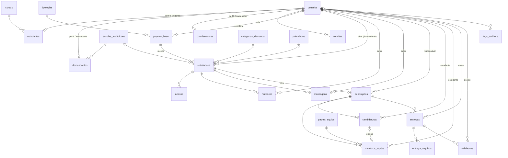

# DER — Plataforma de Gestão de Demandas Tecnológicas

Revisão completa do modelo de dados (Fase 0, 2026-10-18), feita a partir do `PLANO_DE_FASES.md` e das decisões já aprovadas.

**Convenções**
- Banco MySQL/MariaDB, `utf8mb4`. Nomes de tabelas e colunas em português, no plural e em `snake_case`.
- Colunas padrão do Laravel mantidas em inglês: `id`, `created_at`, `updated_at`, `password`, `remember_token`, `email_verified_at`.
- Listas fixas (status, perfil, modalidade, complexidade) ficam em colunas `string` validadas por *Enums* do PHP. Listas que o admin pode ampliar ficam em tabelas de domínio.
- Toda chave estrangeira tem índice. Exclusões usam `restrict` por padrão: registros com histórico não são apagados, são inativados.

---

## 1. Diagrama geral

---

## 2. Dicionário de dados por fase

### Fase 1 — Usuários e perfis

**`usuarios`** — uma linha por pessoa que acessa o sistema.

| Coluna | Tipo | Regras |
|---|---|---|
| id | bigint PK | |
| nome | varchar(150) | obrigatório |
| email | varchar(150) | obrigatório, único |
| email_verified_at | timestamp | nulo até confirmar o e-mail |
| password | varchar(255) | hash (bcrypt) |
| perfil | varchar(20) | `admin`, `coordenador`, `demandante`, `estudante` |
| status | varchar(20) | `pendente`, `ativo`, `inativo`, `rejeitado` |
| motivo_status | text | obrigatório ao rejeitar ou inativar |
| telefone | varchar(20) | opcional; obrigatório para demandante |
| aprovado_por | FK `usuarios` | nulo; quem aprovou |
| aprovado_em | timestamp | nulo |
| remember_token, created_at, updated_at | | padrão Laravel |

**`estudantes`** (1:1 com `usuarios`)

| Coluna | Tipo | Regras |
|---|---|---|
| usuario_id | PK, FK `usuarios` | |
| matricula | varchar(20) | obrigatório, único |
| curso_id | FK `cursos` | obrigatório |

**`demandantes`** (1:1 com `usuarios`)

| Coluna | Tipo | Regras |
|---|---|---|
| usuario_id | PK, FK `usuarios` | |
| escola_instituicao_id | FK `escolas_instituicoes` | obrigatório |
| cargo | varchar(100) | obrigatório |

**`coordenadores`** (1:1 com `usuarios`)

| Coluna | Tipo | Regras |
|---|---|---|
| usuario_id | PK, FK `usuarios` | |
| siape | varchar(20) | opcional, único |
| departamento | varchar(150) | opcional |

**`escolas_instituicoes`**

| Coluna | Tipo | Regras |
|---|---|---|
| id | bigint PK | |
| nome | varchar(200) | obrigatório |
| tipo | varchar(30) | `escola_publica`, `escola_privada`, `instituicao`, `outro` |
| codigo_inep | varchar(8) | opcional, único |
| cidade | varchar(100) | obrigatório |
| uf | char(2) | obrigatório |
| telefone, email | | opcionais |
| ativo | boolean | padrão `true` |

**`cursos`** — `id`, `nome` (único), `ativo`.

**`convites`** — convite do admin para o Coordenador projeto de extensão.

| Coluna | Tipo | Regras |
|---|---|---|
| id | bigint PK | |
| email | varchar(150) | obrigatório |
| perfil | varchar(20) | hoje só `coordenador` |
| token_hash | char(64) | SHA-256 do token; o token puro só vai no e-mail |
| criado_por | FK `usuarios` | admin |
| expira_em | timestamp | ex.: 7 dias |
| usado_em | timestamp | nulo até ser usado; uso único |

Tabelas padrão do Laravel que continuam: `password_reset_tokens`, `sessions`, `cache`, `jobs`, `failed_jobs`.

### Fase 2 — Domínios e Projetos Base

**`tipologias`**, **`categorias_demanda`** — `id`, `nome` (único), `ativo`.

**`prioridades`** — `id`, `nome` (único), `ordem` (para ordenar a fila), `ativo`.

**`projetos_base`** — o projeto de extensão.

| Coluna | Tipo | Regras |
|---|---|---|
| id | bigint PK | |
| titulo | varchar(150) | obrigatório |
| descricao | text | obrigatório |
| escopo_preliminar | text | opcional |
| data_inicio | date | obrigatório |
| data_fim | date | opcional; ≥ `data_inicio` |
| tipologia_id | FK `tipologias` | obrigatório |
| coordenador_id | FK `usuarios` | perfil `coordenador`; nulo só no "Demandas Gerais" até o admin definir |
| publico | boolean | padrão `true`; aparece na página pública (RF14) |
| ativo | boolean | padrão `true`; só ativos recebem demandas |

Seeder: Projeto Base **"Demandas Gerais"** (decisão da Fase 0).

### Fase 3 — Demandas

**`solicitacoes`** — a demanda aberta pelo demandante.

| Coluna | Tipo | Regras |
|---|---|---|
| id | bigint PK | |
| projeto_base_id | FK `projetos_base` | obrigatório |
| demandante_id | FK `usuarios` | perfil `demandante` |
| escola_instituicao_id | FK `escolas_instituicoes` | copiado do demandante na abertura, para os relatórios não mudarem se ele trocar de escola |
| titulo | varchar(100) | obrigatório |
| descricao | text | obrigatório |
| justificativa | text | obrigatório |
| publico_afetado | varchar(255) | obrigatório |
| status | varchar(30) | `cadastrada`, `em_analise`, `priorizada`, `em_desenvolvimento`, `em_validacao`, `aguardando_ajustes`, `concluida`, `recusada`, `cancelada`; mudança sempre manual |
| motivo_status | text | obrigatório para `recusada` e `cancelada` |
| categoria_id | FK `categorias_demanda` | nulo até a triagem |
| prioridade_id | FK `prioridades` | nulo até a triagem |
| complexidade | varchar(10) | `baixa`, `media`, `alta`; nulo até a triagem |
| triado_por | FK `usuarios` | nulo |
| triado_em | timestamp | nulo |

**`anexos`** — arquivos da abertura da demanda (PDF/JPG/PNG, até 5 MB).

| Coluna | Tipo | Regras |
|---|---|---|
| id | bigint PK | |
| solicitacao_id | FK `solicitacoes` | |
| nome_original | varchar(255) | |
| caminho | varchar(255) | dentro de `storage/app/private` |
| mime | varchar(100) | |
| tamanho_bytes | int unsigned | |
| enviado_por | FK `usuarios` | |

### Fase 4 — Rastreabilidade e comunicação

**`historicos`** — linha do tempo da demanda (somente inclusão, nunca edição).

| Coluna | Tipo | Regras |
|---|---|---|
| id | bigint PK | |
| solicitacao_id | FK `solicitacoes` | |
| usuario_id | FK `usuarios` | quem fez; nulo só se a mudança não veio de um usuário logado (ex.: comando de manutenção) |
| tipo | varchar(30) | `status`, `triagem`, `subprojeto`, `carga_horaria`, `equipe`, `entrega`, `validacao`, `outro` |
| descricao | varchar(255) | texto exibido na linha do tempo |
| dados | json | detalhes, ex.: `{"de": 40, "para": 60}` para carga horária ou `{"de": "priorizada", "para": "em_desenvolvimento"}` |
| created_at | timestamp | |

**`mensagens`** — chat da demanda: `id`, `solicitacao_id`, `usuario_id`, `perfil` (perfil do autor no momento do envio), `texto` (até 2.000 caracteres), `created_at`. Não é editada nem apagada.

### Fase 5 — Sub-projetos e equipe

**`subprojetos`** — a demanda em execução (1:1 com `solicitacoes`).

| Coluna | Tipo | Regras |
|---|---|---|
| id | bigint PK | |
| solicitacao_id | FK `solicitacoes` | **único** |
| coordenador_id | FK `usuarios` | responsável (quem criou) |
| titulo | varchar(150) | pré-preenchido da demanda |
| escopo | text | obrigatório |
| data_inicio | date | obrigatório |
| data_fim | date | obrigatório; ≥ `data_inicio` |
| carga_horaria_estimada | smallint unsigned | horas; editável em qualquer status pelo admin ou coordenador; cada mudança gera `historicos.tipo = carga_horaria` |
| vagas | smallint unsigned | mínimo 1 |
| modalidade | varchar(15) | `remoto`, `presencial`, `hibrido` |
| candidaturas_abertas | boolean | fecha quando a equipe completa as vagas ou pelo coordenador |

O Projeto Base do sub-projeto vem de `solicitacoes.projeto_base_id`. Não há uma coluna repetida em `subprojetos`, para os dois valores nunca ficarem diferentes.

**`candidaturas`**

| Coluna | Tipo | Regras |
|---|---|---|
| id | bigint PK | |
| subprojeto_id | FK `subprojetos` | |
| estudante_id | FK `usuarios` | perfil `estudante`, status `ativo` |
| status | varchar(15) | `pendente`, `aprovada`, `recusada`, `cancelada` |
| avaliado_por | FK `usuarios` | nulo |
| avaliado_em | timestamp | nulo |
| | | **único** (`subprojeto_id`, `estudante_id`) |

**`papeis_equipe`** — `id`, `nome` (único), `ativo`. Seeder: Membro Desenvolvedor, Responsável Técnico, Apoio de Campo.

**`membros_equipe`**

| Coluna | Tipo | Regras |
|---|---|---|
| id | bigint PK | |
| subprojeto_id | FK `subprojetos` | |
| estudante_id | FK `usuarios` | |
| papel_id | FK `papeis_equipe` | |
| candidatura_id | FK `candidaturas` | nulo se o coordenador adicionou direto |
| removido_em | timestamp | nulo; remoção sem apagar o histórico |
| | | **único** (`subprojeto_id`, `estudante_id`) |

Regra: membros ativos (`removido_em` nulo) ≤ `subprojetos.vagas`.

### Fase 6 — Entregas e validação

**`entregas`**

| Coluna | Tipo | Regras |
|---|---|---|
| id | bigint PK | |
| subprojeto_id | FK `subprojetos` | |
| enviado_por | FK `usuarios` | membro ativo da equipe |
| tipo | varchar(20) | `link`, `relatorio`, `arquivos` |
| titulo | varchar(150) | obrigatório |
| descricao | text | opcional |
| url | varchar(500) | obrigatório quando `tipo = link` |

**`entrega_arquivos`** — até 5 por entrega; PDF, DOCX, JPG, PNG, ZIP; até 20 MB cada. Colunas: `id`, `entrega_id`, `nome_original`, `caminho`, `mime`, `tamanho_bytes`.

**`validacoes`**

| Coluna | Tipo | Regras |
|---|---|---|
| id | bigint PK | |
| entrega_id | FK `entregas` | |
| etapa | varchar(15) | `tecnica` (coordenador) ou `homologacao` (demandante) |
| decisao | varchar(20) | técnica: `aprovada` / `devolvida`; homologação: `homologada` / `pendencia` |
| feedback | text | obrigatório quando `devolvida` ou `pendencia` |
| usuario_id | FK `usuarios` | quem decidiu |
| created_at | timestamp | |

**RF15 (relatório por extensionista)** não precisa de tabela nova. É uma consulta em `membros_equipe` → `subprojetos` → `solicitacoes` → `projetos_base` / `escolas_instituicoes`, que usa `data_inicio`, `data_fim` e `carga_horaria_estimada` do sub-projeto.

### Fase 7 — Complementos

**`logs_auditoria`** — `id`, `usuario_id` (nulo para ações anônimas), `acao`, `entidade`, `entidade_id`, `dados` (json), `ip`, `created_at`.

**`parametros`** — `chave` (PK), `valor`, `descricao`, `updated_at`.

---

## 3. Mudanças em relação ao plano anterior

| Mudança | Motivo |
|---|---|
| Matrícula, curso, cargo etc. saem de `usuarios` e vão para `estudantes`, `demandantes` e `coordenadores` (1:1) | O plano dizia as duas coisas; tabelas por perfil evitam colunas vazias e deixam as regras de cada cadastro separadas |
| Nova tabela `papeis_equipe` | "Funções de campo" é uma lista aberta; o admin pode acrescentar papéis sem mudar o código |
| Nova tabela `entrega_arquivos` | Uma entrega pode ter até 5 arquivos |
| `solicitacoes.escola_instituicao_id` | Os relatórios continuam corretos se o demandante trocar de escola |
| `subprojetos` sem `projeto_base_id` próprio | O valor vem da solicitação; evita inconsistência |
| `membros_equipe.removido_em` | Remover alguém da equipe não apaga o histórico de participação |
| `projetos_base.publico` | Controla o que aparece na página pública (RF14) |
| `historicos.dados` (json) | Guarda valor anterior e novo, inclusive das mudanças de carga horária |

## 4. Pontos confirmados pelo autor (2026-10-18)

1. **Escola/instituição no cadastro do demandante:** o demandante escolhe a escola em uma lista; se não encontrar, digita uma nova, que o admin confere junto com a aprovação do cadastro.
2. **Membro removido no relatório (RF15):** quem foi removido da equipe **não** aparece no relatório daquele sub-projeto.
3. **Papéis da equipe:** começar com Membro Desenvolvedor, Responsável Técnico e Apoio de Campo; o admin cadastra outros.
4. **Página pública (RF14):** todo Projeto Base ativo aparece por padrão; o coordenador pode ocultá-lo desmarcando `publico`.
